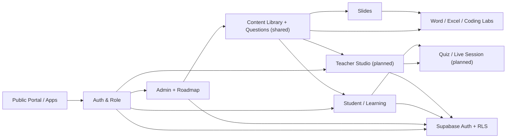

# Sản phẩm, module và luồng nghiệp vụ — Xưởng Công Nghệ

> **Tài liệu chuẩn / product map** · Cập nhật 30/10/2026. Đọc khi sửa nghiệp vụ, điều hướng, Teacher Studio hoặc module dùng chung. Trạng thái dự kiến không được hiểu là đã triển khai.
> Đầu mối: [INDEX.md](INDEX.md) · Kỹ thuật: [ARCHITECTURE_AND_SECURITY.md](ARCHITECTURE_AND_SECURITY.md) · Công việc: [ROADMAP.md](ROADMAP.md).

## 1. Tầm nhìn và nguyên tắc

**Xưởng Công Nghệ** là hệ sinh thái học và thực hành năng lực số với vòng lặp **Học → Luyện → Ứng dụng**, ưu tiên Tin học và các kỹ năng Word, Excel, lập trình, phân tích dữ liệu. Slogan: **Học để hiểu. Làm để thành thạo.**

Trụ cột công khai: Khóa học · Luyện tập · Tài nguyên · Công cụ · Dự án.

Nhóm sử dụng: người tự học, học sinh, giáo viên, người đi làm; tổ/bộ môn và nhà trường ở giai đoạn sau.

Nguyên tắc sản phẩm:
1. Một học liệu/câu hỏi/bài giảng có ID và phiên bản ổn định, tạo một lần, sử dụng ở nhiều ngữ cảnh.
2. Mỗi bài học dẫn đến thao tác hoặc sản phẩm thật; có phản hồi đúng lúc.
3. Không biến công cụ học tập thành CMS/Admin; mỗi vai trò vào đúng không gian và dùng quyền thật.
4. Không copy thiết kế, tài liệu, mã nguồn hoặc tài sản của trang tham khảo; chỉ học luồng sản phẩm.

Chỉ số MVP: hoàn thành bài/quiz đầu, quay lại sau 7 ngày, tiến độ đúng, số bài thực hành hoàn chỉnh.

## 2. Bản đồ module và liên kết kỹ thuật

| Mã | Module | Source of truth cho code | Kết nối chính | Tài liệu cần đọc thêm |
| --- | --- | --- | --- | --- |
| CORE | App shell, navigation, theme | `src/app`, `src/components`, `src/config` | Tất cả domain | [UI_DESIGN_SYSTEM.md](UI_DESIGN_SYSTEM.md) |
| AUTH | Supabase Auth, role, SSR, middleware | `src/features/auth`, `src/lib/supabase`, `src/middleware.ts` | ADMIN, STUDENT, QUIZ, CONTENT, TEACHER | [ARCHITECTURE_AND_SECURITY.md](ARCHITECTURE_AND_SECURITY.md), [SUPABASE_SETUP.md](SUPABASE_SETUP.md) |
| ADMIN | Bảng quản trị, cấu hình, người dùng, monitoring | `src/features/admin`, `src/app/admin` | AUTH, CONTENT, ROADMAP, STORAGE | [SYSTEM_AUDIT_2026-10-30.md](SYSTEM_AUDIT_2026-10-30.md) |
| ROADMAP | Đầu việc, bản nháp, backup, event, version | `src/features/admin/roadmap-*.ts`, `src/app/api/admin/roadmap` | ADMIN, AUTH, Supabase tables | [ROADMAP.md](ROADMAP.md), [XCN_FUNCTION_ROADMAP_CHECKLIST.md](XCN_FUNCTION_ROADMAP_CHECKLIST.md) |
| CONTENT | Khóa học/chương/bài | `src/features/courses`, `src/app/(public)/khoa-hoc` | AUTH, LEARNING, STORAGE | [ROADMAP.md](ROADMAP.md) |
| LEARNING | Học, bài nộp, tiến độ và trắc nghiệm | `src/features/learning`, `src/app/student`, `src/app/api/quiz` | AUTH, CONTENT, QUIZ, LAB | [ARCHITECTURE_AND_SECURITY.md](ARCHITECTURE_AND_SECURITY.md) |
| SLIDES | Thư viện và trình chiếu bài Tin học | `src/features/presentations`, `src/app/(presentation)` | CONTENT, tương lai QUIZ/LIVE | [SLIDE_STANDARD.md](SLIDE_STANDARD.md), [PRESENTATION_DESIGN_STANDARD.md](PRESENTATION_DESIGN_STANDARD.md), [PPT_INTEGRATION.md](PPT_INTEGRATION.md) |
| WORD | Mô phỏng soạn thảo Word độc lập | `src/features/word-simulator`, `src/app/(word-simulator)` | tương lai LEARNING, bài nộp/rubric | [WORD_SIMULATOR_STANDARD.md](WORD_SIMULATOR_STANDARD.md) |
| STORAGE | Kho tài liệu riêng tư | `src/lib/storage`, `src/features/admin/components/admin-document-library.tsx` | AUTH, ADMIN, tương lai CONTENT | [SUPABASE_STORAGE.md](SUPABASE_STORAGE.md) |
| TEACHER | Teacher Studio, lớp, bài tập, phiên Live | **DỰ KIẾN — chưa có module hoàn chỉnh** | AUTH, CONTENT, LEARNING, QUIZ, SLIDES, STORAGE | [XUONG_CONG_NGHE_MASTER_PLAN_2026_2028.md](XUONG_CONG_NGHE_MASTER_PLAN_2026_2028.md) |
| LABS | Excel/Coding/SQL/HTML thực hành | Word Lab là phần đã có; phần còn lại **DỰ KIẾN** | AUTH, CONTENT, LEARNING, STORAGE | [WEBSITE_REFERENCES.md](WEBSITE_REFERENCES.md) |

**Không thêm 2 module chỉ vì tên tương tự.** Một module nắm dữ liệu nghiệp vụ, các module khác tương tác qua API/service hoặc định danh chung. Mọi shared component đặt `src/components` chỉ khi ít nhất hai module cần dùng.

Đây là *bản đồ nghiệp vụ hướng tới*, không phải đồ thị import đã được kiểm chứng; CORE, AUTH, ADMIN, LEARNING, SLIDES và WORD có mã nguồn đang tồn tại.

## 3. Route hiện có so với dự định

**Đã có file route trong repository:** website công khai `/`, `/khoa-hoc`, `/cong-cu`, `/cong-cu/trinh-chieu`; mô phỏng `/cong-cu/mo-phong-word`; Student `/student`, `/student/quiz`, `/student/khoa-hoc/[courseSlug]/[lessonSlug]`; Admin `/admin`, `/admin/roadmap`, `/admin/sitemap`, `/admin/nguoi-dung`, `/admin/phan-quyen`, `/admin/cau-hinh`, `/admin/nhat-ky`, `/admin/he-thong`, `/admin/bao-cao`, `/admin/khoa-hoc`, `/admin/kho-tai-lieu`; Auth `/dang-nhap`, `/dang-ky`, `/quen-mat-khau`, `/doi-mat-khau`, `/auth/callback`.

**Lưu ý:** Có file route ≠ tính năng/DB đã nghiệm thu. CI Chromium kiểm tra Demo, còn QA đủ hai JWT thật vẫn thiếu; rà [SYSTEM_AUDIT_2026-10-30.md](SYSTEM_AUDIT_2026-10-30.md).

**Đề xuất dài hạn, chưa có route hoàn chỉnh:** `/giao-vien/*`, `/hoc-sinh/*`, `/tham-gia`, `/play/[code]`, `/truong/*`, Excel Lab, Coding/SQL Lab. Không đổi route hiện tại trước khi thiết kế chuyển hướng và SEO.

### Teacher Studio — quyết định cổng phát triển 31/10/2026

**P0 JWT/Roadmap trên staging PASS, mở giai đoạn phân tích và phát triển trên staging; chưa mở Production.** Chưa có tài khoản `teacher` để kiểm thử quyền giáo viên và chưa có schema lớp/bài giao; không suy từ quyền Admin trên Roadmap sang quyền Teacher.

**Phạm vi MVP đề xuất, theo đúng thứ tự phụ thuộc:**

1. **Lớp học:** một giáo viên sở hữu lớp; năm học/môn, mã lớp, trạng thái, phân quyền và audit. Tạo schema `classes` có owner UUID, chỉ thay qua migration staging; chưa sửa `courses` hay `enrollments` để dùng tạm thay lớp.
2. **Thành viên lớp:** quan hệ `class_memberships` phân biệt người phụ trách và học sinh, ràng buộc một người vào đúng lớp; Student chỉ xem lớp/bản ghi của mình, Teacher chỉ quản lý lớp mình phụ trách; kiểm cross-class IDOR và thu hồi thành viên.
3. **Bài được giao:** `assignments` tham chiếu bài học/câu hỏi qua ID/phiên bản hiện có, không nhân đôi ngân hàng câu hỏi; bài làm/điểm và lịch sử được quản lý ở module Learning, không cho Student tự sửa kết quả.
4. **UI Teacher và Student:** tạo lớp, mời/vào bằng mã, giao bài, xem tiến độ; loading/empty/error/permission/mobile theo [UI_DESIGN_SYSTEM.md](UI_DESIGN_SYSTEM.md).
5. **Chốt release:** cần ít nhất tài khoản `teacher` staging và Student ở 2 lớp khác nhau để kiểm RLS `USING/WITH CHECK`, server authorization, mất kết nối, refresh, API 401/403, test 11 trang Admin sau login thật, kiểm security advisor và PR có rollback. **Không chỉnh Production RLS trước khi kiểm thử đạt.**

**Ranh giới module:** `src/features/teacher` (mới) sở hữu lớp/thành viên/giao bài; `src/features/learning` tiếp tục sở hữu bài làm và tiến độ; `src/features/courses` sở hữu nội dung học, `src/features/auth` sở hữu session/role. Không tạo shared service khi chỉ một module dùng.

### Bốn workspace sản phẩm

- **Admin:** quản trị nền tảng, người dùng, phân quyền, hệ thống, nội dung và Roadmap; không dùng như trang giáo viên.
- **Teacher Studio:** lớp, học liệu, câu hỏi, bài giao, Live Quiz, kết quả, giáo án (dự kiến).
- **Student Hub:** học/luyện/thực hành, bài được giao, lịch sử và phản hồi.
- **School Manager:** nhiều giáo viên/lớp, phân quyền theo trường (sau này).

## 4. Hợp đồng liên module — phải giữ ổn định

| Hợp đồng | Quy định |
| --- | --- |
| Identity | Chỉ `auth.users.id` (UUID) và `profiles.role` từ server/RLS quyết định quyền; không lấy role client hoặc user metadata. |
| Content | Đề xuất chuẩn hóa `resource_id`, `kind`, `owner_id`, `version`, `visibility`; chỉ áp schema khi có migration/review. |
| Assignment | Teacher chọn content/version gắn class; Student nộp theo assignment, ghi audit. Chưa xây, không tạo schema giả. |
| Quiz/Live | Chấm tại máy chủ; đáp án đúng không xuất trước nộp/công bố; state phiên chính ở server. |
| Labs | Bài thực hành có `attempt` và rubric; chạy code học viên trong sandbox cách ly, không trong Next.js server. |
| Slides | Slide có thể tham chiếu ID bài/câu hỏi, không fork nội dung hoặc câu trả lời. |
| Files | Storage private, signed URL ngắn hạn, kiểm quyền ở server; không dùng link công khai cho bài nộp. |
| Events | Roadmap có phiên bản và event riêng; sự kiện học tập/câu hỏi sau này tách theo domain để tránh lẫn nghiệp vụ. |
| UI | Mỗi màn có loading/empty/error/mobile, hỗ trợ bàn phím và trạng thái không có quyền. |

## 5. Ưu tiên Roadmap

1. P0: **JWT Admin/Student và Roadmap CRUD/backup/restore đã PASS trên staging** (31/10); kiểm toán RLS ngoài Roadmap, bảo mật RPC và E2E Next.js vẫn là gate chưa đạt.
2. P1: nghiệm thu 11 route Admin sau login thật; hợp nhất tri thức sản phẩm/kho câu hỏi dùng chung.
3. P2: Teacher Studio (lớp, học sinh, giao bài) có migration và quyền; sau đó Live Quiz.
4. P2–P3: cải tiến Word/Slides, Excel/Coding Labs, AI giáo dục có kiểm soát, trò chơi dùng chung câu hỏi.
5. Phát triển domain app-specific như `word.xuongcongnghe.net` ở giai đoạn có quyền sở hữu DNS/kiểm thử session; xem [WEBSITE_REFERENCES.md](WEBSITE_REFERENCES.md).

**Lịch sử chi tiết:** [XUONG_CONG_NGHE_MASTER_PLAN_2026_2028.md](XUONG_CONG_NGHE_MASTER_PLAN_2026_2028.md) và [XCN_FUNCTION_ROADMAP_CHECKLIST.md](XCN_FUNCTION_ROADMAP_CHECKLIST.md). Tài liệu nền tảng gốc trước khi gộp: [archive/FOUNDATION_ORIGINALS_BEFORE_2026-10-30.md](archive/FOUNDATION_ORIGINALS_BEFORE_2026-10-30.md).
