# Sitemap toàn hệ thống — Xưởng Công Nghệ

> Ngày cập nhật 2026-10-26. **Đây là sơ đồ chức năng mục tiêu** — nét liền chỉ luồng điều hướng, không hàm ý route đã tồn tại.  
> Danh mục đường dẫn đã triển khai/dự kiến được phân biệt trực tiếp tại `/admin/sitemap`.

```mermaid
flowchart TD
 A["XƯỞNG CÔNG NGHỆ — /"] --> P["Công khai"]
 A --> I["Tài khoản & phân quyền"]
 A --> TE["Teacher Studio"]
 A --> ST["Student Hub"]
 A --> LAB["Learning Labs — Tin học"]
 A --> RES["Thư viện & khóa học"]
 A --> AD["Admin toàn hệ thống"]
 A --> SC["School Manager"]

 P --> PH["Landing, giới thiệu, tính năng"]
 P --> PC["Khám phá công cụ"]
 P --> JOIN["Tham gia phòng / mã PIN"]

 I --> LOGIN["Đăng nhập / đăng ký"]
 I --> PROFILE["Hồ sơ đa vai trò"]

 TE --> TE1["Tổng quan giáo viên"]
 TE --> TE2["Lớp & danh sách học sinh"]
 TE --> TE3["Ngân hàng câu hỏi"]
 TE --> TE4["Tạo đề / giao bài / chấm"]
 TE --> TE5["Bài giảng & trình chiếu"]
 TE --> TE6["Live Quiz: host & projector"]
 TE --> TE7["Báo cáo lớp"]

 ST --> ST1["Dashboard học sinh"]
 ST --> ST2["Lớp / bài được giao"]
 ST --> ST3["Luyện tập / thi"]
 ST --> ST4["Vào Live Quiz"]
 ST --> ST5["Tiến độ và kết quả"]

 LAB --> W["Word Lab"]
 LAB --> E["Excel Lab"]
 LAB --> PT["PowerPoint Lab"]
 LAB --> WIN["Windows / File Explorer"]
 LAB --> PY["Python Practice"]
 LAB --> SQL["SQL Practice"]

 RES --> LIB["Học liệu & ngân hàng chung"]
 RES --> PATH["Lộ trình kỹ năng Tin học"]
 RES --> COURSE["Lớp học, giảng viên, ghi danh"]

 AD --> A1["Tổng quan hệ thống"]
 AD --> A2["Roadmap dọc"]
 AD --> A3["Sitemap"]
 AD --> A4["Khóa học & tài liệu"]
 AD --> A5["Tài khoản & phân quyền"]
 AD --> A6["Logs, cấu hình, giám sát"]

 SC --> SC1["Quản lý trường / tổ / năm học"]
 SC --> SC2["Quản trị giáo viên / lớp"]
 SC --> SC3["Báo cáo theo vai trò"]
```

## Ma trận không gian và trạng thái

| Khu vực | Đường dẫn có trong repository | Đường dẫn quy hoạch |
| --- | --- | --- |
| Website công khai | `/`, `/khoa-hoc`, `/cong-cu`, `/dang-nhap`, `/dang-ky` | `/tham-gia`, `/thu-vien`, `/ho-tro` |
| Admin | `/admin`, `/admin/roadmap`, `/admin/sitemap`, `/admin/khoa-hoc`, `/admin/kho-tai-lieu` | `/admin/nguoi-dung`, `/admin/cau-hinh`, `/admin/phan-quyen` |
| Giáo viên | Chưa có một Teacher Studio hoàn chỉnh | `/giao-vien/*` |
| Học sinh | `/student`, `/student/quiz` | `/hoc-sinh/*`, `/play/[code]` |
| Tin học | `/cong-cu/trinh-chieu`, `/cong-cu/mo-phong-word` | `/thuc-hanh/word|excel|powerpoint|windows|python|sql` |
| Khóa học | `/khoa-hoc` | `/lo-trinh/*`, `/lop-hoc/*` |
| Nhà trường | Chưa có | `/truong/*` |

## Header Landing Page

Desktop: **Logo | Khám phá | Giáo viên | Học sinh | Công cụ | Thực hành | Thư viện | Trò chơi | Tham gia phòng | Tài khoản**.

- Khi chưa đăng nhập: Đăng nhập và Đăng ký; khách có thể xem tài nguyên công khai và nhập PIN khi phòng cho phép.
- Khi đăng nhập: Avatar, tên hiển thị, vai trò hiện tại; menu Hồ sơ, Không gian phù hợp, Cài đặt, Đăng xuất.
- Không cấp quyền quản trị dựa trên lựa chọn vai trò từ form đăng ký; quyền thật được kiểm tra phía server.
- Mobile: header thu gọn, ưu tiên vào phòng nhanh và lộ trình Tin học.

## Luồng người dùng trọng tâm

1. GV → tạo lớp → soạn câu hỏi → tạo đề hoặc chèn slide → Live Quiz → xem báo cáo lớp.
2. HS → tham gia lớp/nhập PIN → làm bài trên điện thoại → xem kết quả khi được công bố → luyện lại.
3. Người tự học → khám phá lộ trình Tin học → chọn Word/Excel/Python/SQL Lab → thực hành → lưu tiến độ.
4. Admin → dashboard → roadmap/sitemap → quản trị nội dung/quyền → kiểm tra trạng thái phát triển và vận hành.

**Lưu ý:** Đừng xây tất cả phân hệ mới trước khi hoàn thành Admin/Roadmap, nền tài khoản, câu hỏi và lớp học. Lộ trình công việc đầy đủ ở `docs/XCN_FUNCTION_ROADMAP_CHECKLIST.md`.
