# Lưu trữ nguyên văn các tài liệu nền tảng trước hợp nhất — 30/10/2026

> Snapshot nguyên văn để không mất quyết định, quy chuẩn hoặc sơ đồ cũ. Các nội dung trạng thái lịch sử không phải trạng thái Production hiện tại. Đọc bản chuẩn mới qua ../INDEX.md.

## Nguyên bản: docs/PRODUCT.md

---

# Product v1.0

## Tầm nhìn

Xưởng Công Nghệ giúp người Việt phát triển năng lực số bằng một chu trình liền mạch: **học kiến thức, luyện kỹ năng, ứng dụng vào việc thật**.

## Đối tượng

- Học sinh, sinh viên cần năng lực số nền tảng.
- Người đi làm muốn dùng Excel, Word, AI và dữ liệu hiệu quả hơn.
- Giáo viên cần học liệu, bài luyện và công cụ hỗ trợ.
- Người tự học muốn có lộ trình ngắn, rõ, thiên về thực hành.

## Giá trị khác biệt

1. Mỗi nội dung học phải dẫn tới một thao tác hoặc sản phẩm.
2. Phản hồi ngay qua quiz và lab.
3. Lộ trình rõ nhưng cho phép học từng nhu cầu nhỏ.
4. Công cụ và dự án thật nối kiến thức với công việc.

## Trụ cột mặt tiền

Khóa học · Luyện tập · Tài nguyên · Công cụ · Dự án. Sản phẩm trả phí không lấn át giá trị học tập ở giai đoạn đầu.

## Chỉ số MVP

- Activation: hoàn thành bài học hoặc quiz đầu tiên.
- Learning: số bài hoàn thành và tỷ lệ đúng theo tuần.
- Retention: người dùng quay lại học trong 7 ngày.
- Outcome: hoàn thành một bài thực hành hoặc dự án.


## Nguyên bản: docs/SCREENS.md

---

# Screens v1.0

## PUBLIC-001 Homepage `/`

Hero định vị, nhóm chủ đề, khóa nổi bật, phòng thực hành, dự án, phương pháp Học–Luyện–Ứng dụng và CTA đăng ký.

## PUB-003 Course Detail `/khoa-hoc/[slug]`

Breadcrumb, thông tin khóa, social proof, CTA học, curriculum và learning outcomes.

## STU-001 Student Dashboard `/student`

KPI học tập, tiếp tục học, mục tiêu tuần, lộ trình và hoạt động gần đây.

## PRA-001 Quiz Player `/student/quiz`

Tiến độ, đồng hồ, câu hỏi một lựa chọn, đánh dấu, phản hồi đúng/sai và điều hướng câu tiếp.

## ADM-001 Admin Dashboard `/admin`

KPI hệ thống, xu hướng hoạt động, phân bố học viên, khóa phổ biến, người dùng mới và CTA quản trị.

## Trạng thái bắt buộc khi mở rộng

Mỗi màn hình dữ liệu phải có loading skeleton, empty state có CTA, error có retry và permission-denied state. Mobile đặt nội dung quan trọng trước biểu đồ phụ.


## Nguyên bản: docs/SITEMAP.md

---

# Sitemap v1.0

```text
Public
├── Trang chủ
├── Khóa học
│   ├── Danh sách
│   └── Chi tiết
├── Luyện tập
│   ├── Trắc nghiệm
│   ├── Excel Lab
│   ├── Word Lab
│   └── Coding Lab
├── Tài nguyên
├── Công cụ
├── Dự án
├── Bài viết
└── Giới thiệu

Student
├── Tổng quan
├── Khóa học của tôi
├── Luyện tập
├── Kết quả
├── Tài nguyên của tôi
├── Sổ tay
└── Hồ sơ

Teacher (sau MVP)
├── Lớp học
├── Bài giảng
├── Bài tập
├── Kiểm tra
├── Học viên
└── Báo cáo

Admin
├── Tổng quan
├── Nội dung
├── Luyện tập
├── Tài nguyên
├── Công cụ & Dự án
├── Người dùng
├── Đơn hàng
└── Hệ thống
```

MVP 0.1 triển khai public homepage/course detail, student dashboard/quiz và admin dashboard. Các route chưa có UI chi tiết vẫn được giữ trong navigation model và roadmap.


## Nguyên bản: docs/XCN_SITEMAP_2026_2028.md

---

# Sitemap toàn hệ thống — Xưởng Công Nghệ

> Ngày cập nhật 2026-10-26. **Đây là sơ đồ chức năng mục tiêu** — nét liền chỉ luồng điều hướng, không hàm ý route đã tồn tại.  
> Danh mục đường dẫn đã triển khai/dự kiến được phân biệt trực tiếp tại `/admin/sitemap`.

```mermaid
flowchart TD
 A["XƯỞNG CÔNG NGHỆ — /"] --> P["Công khai"]
 A --> I["Tài khoản & phân quyền"]
 A --> TE["Teacher Studio"]
 A --> ST["Student Hub"]
 A --> LAB["Learning Labs — Tin học"]
 A --> RES["Thư viện & khóa học"]
 A --> AD["Admin toàn hệ thống"]
 A --> SC["School Manager"]

 P --> PH["Landing, giới thiệu, tính năng"]
 P --> PC["Khám phá công cụ"]
 P --> JOIN["Tham gia phòng / mã PIN"]

 I --> LOGIN["Đăng nhập / đăng ký"]
 I --> PROFILE["Hồ sơ đa vai trò"]

 TE --> TE1["Tổng quan giáo viên"]
 TE --> TE2["Lớp & danh sách học sinh"]
 TE --> TE3["Ngân hàng câu hỏi"]
 TE --> TE4["Tạo đề / giao bài / chấm"]
 TE --> TE5["Bài giảng & trình chiếu"]
 TE --> TE6["Live Quiz: host & projector"]
 TE --> TE7["Báo cáo lớp"]

 ST --> ST1["Dashboard học sinh"]
 ST --> ST2["Lớp / bài được giao"]
 ST --> ST3["Luyện tập / thi"]
 ST --> ST4["Vào Live Quiz"]
 ST --> ST5["Tiến độ và kết quả"]

 LAB --> W["Word Lab"]
 LAB --> E["Excel Lab"]
 LAB --> PT["PowerPoint Lab"]
 LAB --> WIN["Windows / File Explorer"]
 LAB --> PY["Python Practice"]
 LAB --> SQL["SQL Practice"]

 RES --> LIB["Học liệu & ngân hàng chung"]
 RES --> PATH["Lộ trình kỹ năng Tin học"]
 RES --> COURSE["Lớp học, giảng viên, ghi danh"]

 AD --> A1["Tổng quan hệ thống"]
 AD --> A2["Roadmap dọc"]
 AD --> A3["Sitemap"]
 AD --> A4["Khóa học & tài liệu"]
 AD --> A5["Tài khoản & phân quyền"]
 AD --> A6["Logs, cấu hình, giám sát"]

 SC --> SC1["Quản lý trường / tổ / năm học"]
 SC --> SC2["Quản trị giáo viên / lớp"]
 SC --> SC3["Báo cáo theo vai trò"]
```



## Ma trận không gian và trạng thái

| Khu vực | Đường dẫn có trong repository | Đường dẫn quy hoạch |
| --- | --- | --- |
| Website công khai | `/`, `/khoa-hoc`, `/cong-cu`, `/dang-nhap`, `/dang-ky` | `/tham-gia`, `/thu-vien`, `/ho-tro` |
| Admin | `/admin`, `/admin/roadmap`, `/admin/sitemap`, `/admin/khoa-hoc`, `/admin/kho-tai-lieu` | `/admin/nguoi-dung`, `/admin/cau-hinh`, `/admin/phan-quyen` |
| Giáo viên | Chưa có một Teacher Studio hoàn chỉnh | `/giao-vien/*` |
| Học sinh | `/student`, `/student/quiz` | `/hoc-sinh/*`, `/play/[code]` |
| Tin học | `/cong-cu/trinh-chieu`, `/cong-cu/mo-phong-word` | `/thuc-hanh/word|excel|powerpoint|windows|python|sql` |
| Khóa học | `/khoa-hoc` | `/lo-trinh/*`, `/lop-hoc/*` |
| Nhà trường | Chưa có | `/truong/*` |

## Header Landing Page

Desktop: **Logo | Khám phá | Giáo viên | Học sinh | Công cụ | Thực hành | Thư viện | Trò chơi | Tham gia phòng | Tài khoản**.

- Khi chưa đăng nhập: Đăng nhập và Đăng ký; khách có thể xem tài nguyên công khai và nhập PIN khi phòng cho phép.
- Khi đăng nhập: Avatar, tên hiển thị, vai trò hiện tại; menu Hồ sơ, Không gian phù hợp, Cài đặt, Đăng xuất.
- Không cấp quyền quản trị dựa trên lựa chọn vai trò từ form đăng ký; quyền thật được kiểm tra phía server.
- Mobile: header thu gọn, ưu tiên vào phòng nhanh và lộ trình Tin học.

## Luồng người dùng trọng tâm

1. GV → tạo lớp → soạn câu hỏi → tạo đề hoặc chèn slide → Live Quiz → xem báo cáo lớp.
2. HS → tham gia lớp/nhập PIN → làm bài trên điện thoại → xem kết quả khi được công bố → luyện lại.
3. Người tự học → khám phá lộ trình Tin học → chọn Word/Excel/Python/SQL Lab → thực hành → lưu tiến độ.
4. Admin → dashboard → roadmap/sitemap → quản trị nội dung/quyền → kiểm tra trạng thái phát triển và vận hành.

**Lưu ý:** Đừng xây tất cả phân hệ mới trước khi hoàn thành Admin/Roadmap, nền tài khoản, câu hỏi và lớp học. Lộ trình công việc đầy đủ ở `docs/XCN_FUNCTION_ROADMAP_CHECKLIST.md`.


## Nguyên bản: docs/ROLES_PERMISSIONS.md

---

# Roles & Permissions v1.0

| Khả năng | Guest | Student | Teacher | Admin |
|---|---:|---:|---:|---:|
| Xem nội dung public | ✓ | ✓ | ✓ | ✓ |
| Làm quiz miễn phí | ✓ | ✓ | ✓ | ✓ |
| Lưu tiến độ/kết quả | — | own | own | all |
| Ghi danh khóa học | — | own | own | all |
| Tạo ghi chú | — | own | own | all |
| Tạo nội dung học | — | — | own/draft | all |
| Quản lý lớp học | — | — | own | all |
| Xuất bản nội dung | — | — | đề nghị | ✓ |
| Quản lý người dùng | — | — | — | ✓ |
| Quản lý hệ thống | — | — | — | ✓ |

`own` nghĩa là chỉ đọc/ghi dữ liệu gắn với `auth.uid()`. Teacher có trong schema nhưng workspace đầy đủ bị tắt ở MVP. Admin role phải được kiểm tra bằng profile trên server và RLS, không chỉ ẩn/hiện UI.


## Nguyên bản: docs/DATABASE.md

---

# Database v1.0

## Nhóm bảng

- Identity: `profiles`
- Learning content: `courses`, `chapters`, `lessons`
- Learning state: `enrollments`, `lesson_progress`
- Practice: `quizzes`, `questions`, `question_options`, `quiz_attempts`, `quiz_answers`
- Personal: `notes`

## Quy ước

- Primary key UUID, dùng `gen_random_uuid()`.
- Timestamp dùng `timestamptz`; mọi bảng mutable có `updated_at`.
- Slug duy nhất cho tài nguyên public.
- Enum Postgres cho role/status ổn định.
- Xóa nội dung ưu tiên soft delete/status; dữ liệu học tập không cascade ngoài ý muốn.

## RLS

Nội dung published đọc công khai. Student chỉ quản lý enrollment, progress, attempt và note của chính mình. Admin toàn quyền thông qua `profiles.role = 'admin'`. Service role chỉ dùng ở server kín.

Migration mẫu: `supabase/migrations/202608190001_initial_schema.sql`.


## Nguyên bản: docs/ARCHITECTURE.md

---

# Architecture v1.0

## Hướng phụ thuộc

```text
app routes
  → features / presentation components
    → repositories / services
      → Supabase client or mock adapter
```

UI không biết dữ liệu đến từ mock hay Supabase. Giai đoạn tiếp theo tạo interface repository theo từng feature (`courses`, `learning`, `quiz`, `admin`) rồi chọn adapter bằng feature flag.

## Ranh giới thư mục

- `src/app`: route, layout, metadata, server actions.
- `src/features/<domain>`: model, repository, queries, feature UI.
- `src/components/ui`: primitive không chứa business logic.
- `src/components`: shell và pattern dùng nhiều domain.
- `src/config`: navigation, feature flag, product constants.
- `src/lib`: client Supabase, validation, shared utilities.
- `src/data`: dữ liệu giả phục vụ UI và test.

## Render và bảo mật

Public content ưu tiên Server Components. Quiz/player dùng Client Components cho trạng thái tương tác. Route admin kiểm tra session/role ở server khi auth được nối. RLS là lớp bắt buộc cuối cùng; middleware không thay thế RLS.

## Môi trường

Local mặc định mock. Preview/production dùng Supabase riêng, migration đồng bộ qua CI. Không commit `.env.local` hay service-role key.


## Nguyên bản: docs/BRAND.md

---

# Brand v1.1 — Xưởng Công Nghệ

## Định vị
**Xưởng Công Nghệ** — Nền tảng học và thực hành năng lực số.

Slogan: **Học để hiểu. Làm để thành thạo.**

## Tính cách và giọng văn
Rõ ràng, điềm tĩnh, thực tế; ưu tiên câu ngắn, hành động cụ thể, Tiếng Việt tự nhiên. Không lạm dụng hiệu ứng hoặc màu sắc.

## Nhận diện màu chính thức (14/10/2026)

Bảng tham chiếu 4 vòng tròn do người dùng cung cấp:

| Vai trò | Hex | Sử dụng |
|---|---|---|
| Navy / Ink | `#04122D` | Chữ, header/surface tối, vùng tương phản |
| Royal blue / Primary | `#005BFD` | CTA, liên kết quan trọng, tiến độ |
| Cyan / Highlight | `#00E9FD` | Điểm nhấn trên nền navy, hover/selected |
| Ice / Paper | `#F0F6FD` | Nền phụ, phân lớp, khu vực nhẹ |
| White | `#FFFFFF` | Card, nền chính, chữ trên nút blue |

- **Blue** dành cho hành động; **cyan** dành cho điểm nhấn, không hoán đổi tùy hứng.
- Chữ trắng trên blue; chữ navy trên cyan; không dùng chữ cyan trên nền trắng.
- Không dùng lime `#C8F13B` trong nhận diện mới.
- Màu semantic (đỏ lỗi, xanh lá thành công) chỉ dùng khi cần thể hiện trạng thái, không dùng như màu trang trí.
- Hình ảnh ưu tiên sản phẩm, dữ liệu, bài làm; tránh ảnh stock giáo dục.

## Nhật ký và quy tắc
Đọc và cập nhật `docs/WORKLOG_AND_RULES.md` sau **mỗi yêu cầu có thay đổi mã nguồn/giao diện/triển khai**.


## Nguyên bản: docs/DESIGN_SYSTEM.md

---

# Design System v1.1 — Xưởng Công Nghệ

## Nguyên tắc
Minimal Education SaaS: sạch, có hệ thống, khoảng trắng vừa đủ, tương phản dễ đọc, viền mảnh, ít màu trang trí. Chỉ sử dụng trang tham khảo làm cảm hứng, không sao chép.

## Tokens

| Token Tailwind | Giá trị | Vai trò |
|---|---|---|
| `ink` | `#04122D` | Headings, chữ chính, nền tối |
| `blue` | `#005BFD` | Primary CTA, tiến độ, active action |
| `cyan` | `#00E9FD` | Điểm nhấn tương phản trên navy |
| `paper` | `#F0F6FD` | Section phụ, app shell |
| `mist` | `#E1EBF7` | Viền/đường chia mềm |
| `white` | `#FFFFFF` | Card và bề mặt sáng |

Màu lấy từ ảnh tham chiếu 4 swatch người dùng gửi ngày 14/10/2026. **Không còn dùng lime** trong bộ nhận diện.

## Tương phản và khả năng tiếp cận
- `bg-blue text-white`: ~**5.36:1**.
- `bg-ink text-cyan`: ~**12.46:1**.
- `bg-cyan text-ink`, `bg-paper text-ink`: tương phản cao.
- **Tránh** `bg-blue text-ink` và `bg-white text-cyan` với chữ nhỏ.
- Giữ nhãn, biểu tượng, focus ring và phản hồi bằng chữ; không mã hóa trạng thái bằng màu đơn thuần.

## Layout, chữ và hình khối
Manrope cho heading, Be Vietnam Pro cho body. Dùng `xcn-container` đồng nhất và spacing với `clamp()` như `docs/SITE_LAYOUT_STANDARD.md`. Card viền mảnh, radius 12–16px, shadow ít; button có thể dạng pill; không trang trí gradient/glassmorphism tùy tiện.

Trang chủ cuộn liên tục tự nhiên, **không scroll-snap** và không cưỡng ép tất cả section một màn hình. Công cụ trình chiếu toàn màn hình là ngoại lệ độc lập.

## Khi thay đổi hệ thống
1. Ưu tiên token ở `tailwind.config.ts` / `src/app/globals.css`; không tự thêm màu thương hiệu mới.
2. Giữ màu semantic (đúng/sai) và biểu tượng tệp Word/Excel trong nội dung mô phỏng khi màu mang ý nghĩa chuyên môn.
3. Kiểm tra tương phản, 360px/768px/1280px, bàn phím và `pnpm test`, `pnpm typecheck`, `pnpm build`.
4. Sau mỗi công việc phải cập nhật `docs/WORKLOG_AND_RULES.md`; cập nhật `CHANGELOG.md` cho thay đổi người dùng thấy.


## Nguyên bản: docs/SITE_LAYOUT_STANDARD.md

---

# Xưởng Công Nghệ — Layout và typography đồng bộ

## Vùng nội dung
- Dùng **`xcn-container`** cho header công khai, mỗi section trang chủ, danh sách khóa học, công cụ, thư viện trình chiếu và footer. Cùng một max-width **1680px**, gutter responsive **clamp(20px, 2.5vw, 42px)**; điện thoại **18px**.
- Không dùng `max-w-7xl px-5 lg:px-8` trên các vùng cấp trang mới: chúng làm header và nội dung lệch lề khi màn hình lớn.
- Dùng vùng nội dung chung ở các trang học viên/quản trị: app header là `xcn-app-header`, main là `xcn-app-main`. Cả hai lấy đúng cùng gutter, sidebar riêng.
- Biểu mẫu đăng nhập và các đoạn văn đọc dài có thể giữ độ rộng hạn chế, nhưng phần khung trang vẫn cân đối và không lồng hai lớp padding ngang thừa.
- **Ngoại lệ:** công cụ trình chiếu `/cong-cu/trinh-chieu/[lessonId]` luôn hiển thị **full-bleed 100dvh**, không nhận gutter của website.

## Mật độ hiển thị
- Các khối public cơ bản giảm khoảng cách dọc từ 80–96px xuống 48–74px, card giảm padding ở những màn có khoảng trắng lớn.
- Trên website và shell, font phụ `text-xs` tăng từ 12 lên **13px** và `text-sm` từ 14 lên **15px**. Giữ `text-base` tối thiểu **16px** cho nội dung dài; tăng headline của dashboard.
- Không tăng font trong File Explorer mô phỏng, quiz trình chiếu hay slide đang tối ưu cho chiếu lớp.
- Khi tạo trang mới, ưu tiên `xcn-container` thay cho việc tự chọn max-width và hai padding riêng biệt.

## Kiểm soát thay đổi
Chạy `pnpm test`, `pnpm typecheck`, `pnpm build` trước khi merge. Kiểm tra các trang trên desktop và mobile, đặc biệt header có thể xuống dòng khi điều hướng quá dài.

## Mật độ giao diện linh hoạt (cập nhật 14/10/2026)

- `xcn-page-pad`: lề trên/dưới căn theo `clamp(22px, 4.3dvh, 54px)`; `xcn-section-pad`: `clamp(28px, 5.4dvh, 64px)`; `xcn-section-gap`: `clamp(20px, 3.4dvh, 40px)`.
- Header công khai bố trí logo ở trái, điều hướng và hành động liền nhau ở phải. Dưới 900px, thanh điều hướng xuống hàng và cuộn ngang thay vì tràn hoặc ép chữ.
- Trang Công cụ và Thư viện trình chiếu không còn chiều cao tối thiểu cố định cho card hay khối trang; chiều cao theo nội dung thực tế, responsive theo cột.
- Bỏ nhóm thống kê 01/01/29 không thiết yếu ở đầu thư viện để ưu tiên chủ đề có thể mở ngay.
- Hero trang chủ dùng `clamp` với đơn vị `dvh` thay vì chiều cao pixel tuyệt đối, cho phép nội dung nở theo chữ; hình mô phỏng dùng đơn vị tương đối.
- Hệ trình chiếu độc lập giữ toàn màn hình `100dvh`, không áp `xcn-container` hoặc padding trang công khai lên slide.


## Nguyên bản: docs/DECISIONS.md

---

# Quyết định phát triển

## 2026-10-14 — Hệ màu và quy trình ghi chép

- Chốt navy `#04122D`, blue `#005BFD`, cyan `#00E9FD`, ice `#F0F6FD` dựa trên ảnh 4 màu được cung cấp; không dùng lime branding.
- CTA blue chữ trắng; cyan nổi bật trên navy, xanh lá/đỏ chỉ dùng semantic.
- Mọi thay đổi phải ghi vào `docs/WORKLOG_AND_RULES.md` và cập nhật `CHANGELOG.md` khi người dùng nhìn thấy.
- Báo đã cập nhật online chỉ khi Vercel Production `READY`, cùng SHA GitHub `main`, và domain chính được gán.
- Giữ trang chủ cuộn thông thường, không scroll-snap trừ khi có yêu cầu mới.

## 2026-10-12 — Hoàn thiện vòng học mẫu trước backend

- Giữ stack đang chạy: Next.js 15 / React 19 / Tailwind 3 trong giai đoạn này.
- Tạo luồng học thử Excel với 9 bài và 6 câu quiz; không thêm thư viện ngoài.
- Dùng `localStorage` để giữ tiến độ, bài làm và điểm trên cùng một trình duyệt. Đây là storage **demo, không xác thực**, dễ xóa và không đồng bộ giữa máy.
- Không được dùng `correctIndex` gửi sang trình duyệt hay chấm điểm client khi có tài khoản thật. Chuyển scoring sang server trước Supabase integration.
- Migration mới hạn chế quyền xem `question_options.is_correct`, tự sửa `quiz_attempts.score`, `quiz_answers.is_correct` và tự nâng `profiles.role`.
- Trang admin hiện chỉ là mô phỏng, **chưa có route guard**; không nhập dữ liệu thật, không đưa vào môi trường công khai như admin vận hành.
- Tạo CI typecheck và build; chưa coi hoàn thành đến khi pipeline chạy thành công và có kiểm thử browser.

## Quyết định chưa đóng

- Tên thương hiệu, logo, domain và triển khai production.
- Cách thiết kế endpoint nộp quiz và hệ thống entitlement.
- Thư viện mô phỏng spreadsheet cho Excel Lab.
- Teacher Workspace, thanh toán, AI Tutor và Coding Lab nằm sau MVP.


